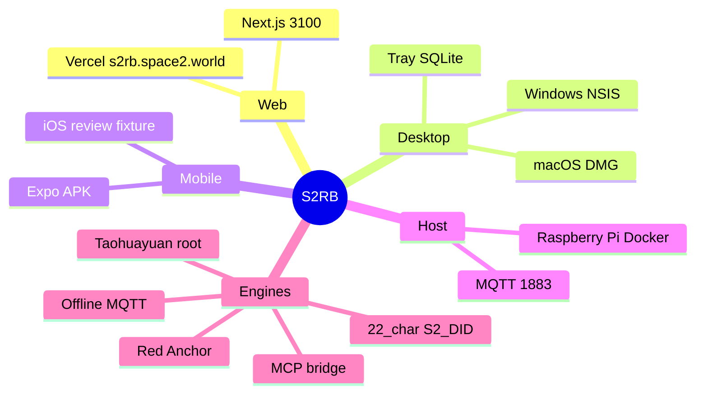

<div align="center">

# S2 Rainbow Bridge (S2RB)

**Federation communication and zero-trust gateway for the carbon–silicon universe.**

[ Website ](https://s2rb.space2.world) · [ Whitepaper EN ](docs/WHITEPAPER.en.md) · [ 中文白皮书 ](docs/WHITEPAPER.zh.md) · [ User manual ](docs/USER_MANUAL.md)

S2RB is an **independent** product. This repository is https://github.com/SpaceSQ/S2RB — not a folder inside S2 AIOS.

[ 🇨🇳 简体中文请向下滚动 ]

</div>

## Background and why it exists

Large models should not cross a continent to turn on a bedroom heater. S2 AIOS already holds one room: the doorplate, the 01 digital human, the 14-axis radar, and `taohuayuan.md`. Isolated rooms still cannot visit each other without becoming a second chat door or leaking dirty scans to the cloud.

S2RB is the Internet layer and supreme customs of that universe. It screens 22-character S2-DIDs on the device, resolves franchise plates through the Taohuayuan root in Changde, runs Red Anchor physical fuses, and offers a read-only MCP plug so Tencent / Alibaba office agents can touch the house physical layer without sitting on throne 01.

Series: **S2-NF-001**. Authority: ROBOTZERO (Guangzhou Linghao Software Technology Co., Ltd.).

## Software structure

```text
S2RB/
  apps/web        Next.js resolver + API  (port 3100, Vercel)
  apps/desktop    Tauri v2 — Windows .exe / macOS .dmg, tray + SQLite
  apps/mobile     Expo / EAS — Android APK / iOS
  apps/host       Docker + systemd — Raspberry Pi / Linux gateway
  packages/mcp    MCP stdio server (get_space_topology)
  docs/           Whitepapers, user manual, S2 AIOS relation
```



## Functional modules

| Engine | Path | What it does |
| --- | --- | --- |
| DID / plate screen | `apps/web/src/s2rb_dns_root.ts` | Length 22, SPACSQ checksum, `LOCAL_REJECT` before `fetch()` |
| Taohuayuan root | `apps/web/src/config.ts` | Cache → local SITE → `TAOHUAYUAN` for MARS/MOON/PHYS/GAME/MYTH |
| Red Anchor | `apps/web/src/red_anchor_sandbox.ts` | 14 axes; tactile > 5 N or oxygen < 19.5% → `VETO_SECURITY` |
| Agent scanner | `apps/web/src/agent_scanner.ts` | Public DID only. No API key in the tree |
| MQTT mailbox | `apps/web/src/s2rb_tunnel.ts` | `S2/rainbow/<DID>/mail`; media relay NONE |
| MCP | `packages/mcp`, `apps/web/src/mcp_gateway.ts` | Read-only `get_space_topology` |
| Reviewer | `apps/web/src/reviewer.ts` | `apple@robot0.com` skips LAN |
| Desktop | `apps/desktop` | Successful handshakes + DID whitelist in local SQLite |
| Mobile | `apps/mobile` | Home Wi-Fi scan of S2 AIOS `:1884/lan` |
| Pi host | `apps/host` | Compose: resolver + Mosquitto |

## Quick start

```bash
git clone https://github.com/SpaceSQ/S2RB.git
cd S2RB/apps/web
npm install
npm test
npm run dev -- --port 3100
```

Windows / Mac desktop:

```bash
cd apps/desktop
npm install
npm run build:dmg    # macOS
npm run build:exe    # Windows
```

Phone:

```bash
cd apps/mobile
npm install
npm run build:apk
```

Raspberry Pi:

```bash
cd apps/host
docker compose up -d
```

Full steps: [docs/USER_MANUAL.md](docs/USER_MANUAL.md).  
How this product sits next to the house OS: [docs/S2_AIOS_RELATION.md](docs/S2_AIOS_RELATION.md).  
House OS (separate repo): https://github.com/SpaceSQ/S2AIOS

## Open Source & License

S2 AIOS / S2RB hold to a hacker spirit of freedom and carbon–silicon coexistence. The core architecture is fully open source.

Copyright (c) 2026 Miles Xiang & RobotZero team

The built-in CD-U6A spatial entitlement specification and the 14-axis tensor engine core algorithms are covered by patent applications filed by Guangzhou Linghao Software Technology Co., Ltd. (ROBOTZERO). All S2 development teams belong to ROBOTZERO. The development lead is Miles Xiang.

S2RB clients are **free for personal use only**. Commercial use, repackaging, and resale of modified copies are forbidden.

Licensed under the Apache License, Version 2.0. See `LICENSE` and `NOTICE`.

> "We hacked the software. Now, we hack the space."
>
> —— S2 AIOS / RobotZero team

---

# S2 彩虹桥 (S2RB)

**碳硅共生宇宙的联邦通讯与零信任网关。**

本仓库是独立产品：https://github.com/SpaceSQ/S2RB ，不是 S2 AIOS 里的一个子目录。

## 背景与意义

大模型不该跨越千万里去开卧室的取暖器。S2 AIOS 已经能守住一间房，但孤岛房间不能互相探访——除非再开一扇聊天门，或把脏扫描送上云。

S2RB 是这个宇宙的互联网层与最高海关：本机筛 22 位 DID，经常德桃花源根解析特许门牌，红锚做物理熔断，MCP 让办公智能体接入家里的物理层，而不能坐上 01 号王座。

系列代号 **S2-NF-001**。发布机构：ROBOTZERO（广州零号软件科技有限公司）。

## 软件结构

| 目录 | 端面 |
| --- | --- |
| `apps/web` | 网站 / 解析 API（3100） |
| `apps/desktop` | Windows / macOS 托盘客户端 |
| `apps/mobile` | Android / iOS |
| `apps/host` | 树莓派 / Linux Docker 网关 |
| `packages/mcp` | MCP 标准工具 |
| `docs/` | 白皮书、说明书、与 S2 AIOS 的关联 |

## 使用说明书与关联

- [使用说明书](docs/USER_MANUAL.md)
- [与 S2 AIOS 的关联](docs/S2_AIOS_RELATION.md)
- [中文白皮书](docs/WHITEPAPER.zh.md)
- S2 AIOS 仓库（另一套产品）：https://github.com/SpaceSQ/S2AIOS

## 开源与版权

S2 AIOS 秉持极客自由精神与碳硅共生理念，核心架构全面开源。

Copyright (c) 2026 Miles Xiang & RobotZero team

系统内置的 CD-U6A 空间确权规范及 14 维张量引擎核心算法专利（专利申请号批次归属广州零号软件科技有限公司）。所有涉及 S2 的开发团队归属于 ROBOTZERO（广州零号软件科技有限公司），开发团队负责人为 Miles Xiang。

S2RB 全系客户端**仅限个人免费使用**，严禁商用、打包及修改后二次销售。

采用 Apache License 2.0。详见 `LICENSE` 与 `NOTICE`。
